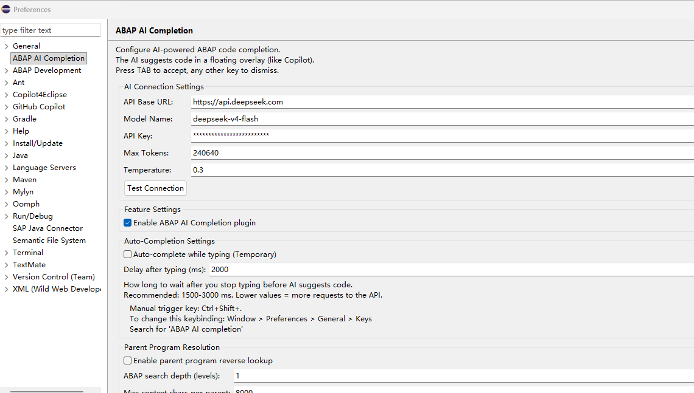
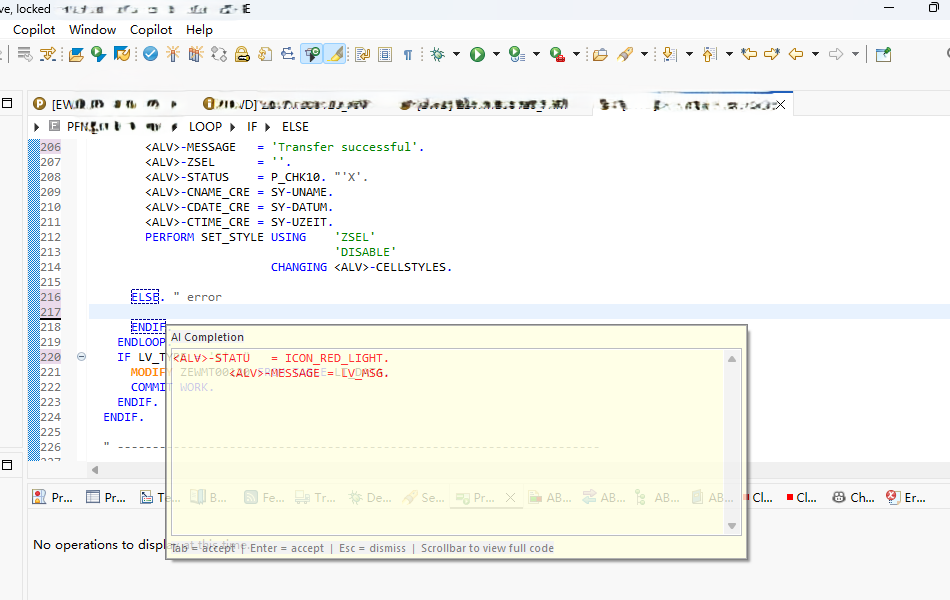
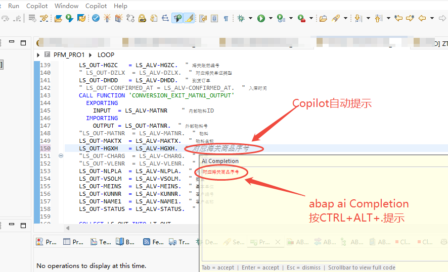

# ABAP AI Completion - Eclipse Plugin

> 🌐 **Language / 语言**: [English](README.md) | [中文](README_CN.md)




## English

An AI code completion plugin for SAP ABAP developers, built for Eclipse. Based on Large Language Models (LLM), it pursues maximum privacy and data security: a local LLM can be used inside the enterprise so that corporate code is never uploaded to the Internet, keeping your code confidential. It provides intelligent code suggestions and auto-completion while you write ABAP code.

### SAP ADT Extension Features
- ** 1. A frequently used template import function is added to the menu; two template programs are currently available.
- ** 2. After a program is modified, the object is added under the "Favorite Objects" node of the SAP project tree. That node sorts by object name and ignores the modification time, so an additional "Recently Modified" node is provided that keeps the most recently modified objects at the top for quick access to your editing history.**
- ** 3. A "Favorite Transaction Codes" function is added to the SAP project tree: maintain frequently used SAP transaction codes and execute them with a single click.
- ** 4. A deep search function for ABAP code is added. ADT does not provide such a function - it can only search inside the current program. This plugin behaves like the ABAP code search in SAP GUI: it searches/replaces across all INCLUDEs of the main program.**

### Token Usage for Code Completion
- ** 1. Tests show that using only the current program or the currently open editors as reference consumes very few tokens, typically a few hundred. At 1000 tokens per completion and DeepSeek at 0.04 CNY per million tokens, 0.04 CNY covers about 1000 completions (the output is negligible), i.e. 1 CNY covers about 25,000 completions - more than enough.
- ** 2. You can also use free models. During testing the free model agnes-2.5-flash from https://agnes-ai.cn/ worked well.

### Advantages over Copilot
- **✅ Local LLM support** : a local LLM can be used inside the enterprise so that corporate code is never uploaded to the Internet, keeping your code confidential.
- **✅ Completely open source, free for enterprise use** : the plugin is fully open source and free for enterprises. No fees, no code-security worries, and you can use it with peace of mind.
- **🤖 Besides the ABAP code of the current editor, AI completion can also include all ABAP code opened in the current workbench. Copilot only supports the code of the current editor and does not offer this.**
- **⌨️ Deep search of related code as reference for completion: programs related to the current program are sent to the AI together as reference. Recursive multi-level search affects performance, so one level is recommended.**
- **🎯 Local SKILLs can be passed in as code reference, so you can define custom functions or template references in a SKILL to obtain more reasonable AI completions. Copilot also supports configurable SKILLs, but they can only be used for chat, not as code reference for completion.**

### Features

- **🤖 AI-powered completion** : based on AI models, provides context-aware ABAP code suggestions at the cursor position

- **⌨️ Manual trigger** : press `Ctrl+Shift+.` to invoke AI code completion manually

- **⚡ Auto completion** : optional auto-completion mode that triggers AI suggestions after typing stops

- **📋 INCLUDE resolution** : automatically resolves ABAP INCLUDE programs for a more accurate completion context

- **🎯 Skill directory** : supports `.abap`, `.txt` and `.skill` files as AI reference patterns

- **🌊 Floating overlay** : code suggestions are shown as a floating overlay (Copilot style)

- **🎨 Custom style** : the display color of the completion code can be customized

- **🔌 Flexible configuration** : supports any service endpoint compatible with the OpenAI Chat Completions API

- ** Manual completion (Ctrl+Shift+.) uses SKILLs; auto completion (requestQuickCompletion) uses a simplified standalone prompt and does not load the contents of the SKILL directory.**

- ** Completion mode configuration : in the preferences you can choose whether manual completion shows a popup overlay (overlay) or inserts directly (direct); both use the SKILL content.**

---

## Installation (for end users)

### System Requirements

- **Eclipse** : 4.7+ (Neon) or higher

- **Java** : JDK 17 or higher

- **Network** : access to the configured AI API service is required

### Installation Methods

There are three installation methods; method 1 (Eclipse Marketplace) is recommended:

#### Method 1: Install from Eclipse Marketplace (recommended)

1. In the Eclipse menu bar open `Help` → `Eclipse Marketplace...`

2. Enter **`ABAP AI`** in the search box and find **`ABAP AI Completion`**

3. Click `Install` and follow the prompts (accept the license, trust the certificate)

4. After installation click `Restart Now (Restart Eclipse)`; the plugin is loaded

#### Method 2: Install with Install New Software

1. In the Eclipse menu bar choose `Help` → `Install New Software...` (on some versions `Help` → `Install Software...`)

2. In the `Available Software` dialog click `Add...` and enter the following update site:

   ```
   Name: ABAP AI Completion
   Location: https://yan252.github.io/ABAP-AI-completion/update-site
   ```

   > 💡 You can also click `Archive...` and select `ABAP-AI-Completion-UpdateSite-1.0.5.zip` for an offline installation.

3. Check `ABAP AI Completion Feature`, click `Next` → `Next` → accept the license → `Finish`

4. After installation click `Restart Now (Restart Eclipse)`; the plugin is loaded

#### Method 3: dropins (debugging/development only)

Copy `dist/com.sap.abap.ai.completion_1.0.5.jar` into the `<Eclipse install>/dropins/` directory of your Eclipse installation (create the directory if it does not exist) and restart Eclipse.

---

## Usage

### Manual code completion

1. Open any ABAP source file (`.abap`, `.prog`, etc.)

2. Place the cursor where the completion is needed

3. Press `Ctrl + Shift + .` to invoke AI completion

4. The AI suggestion is shown as a floating overlay

5. Press `Tab` to accept the suggestion; any other key cancels it

### Auto-completion mode

After enabling **"Auto-complete while typing"** in the configuration, AI suggestions are triggered automatically when typing pauses (default 2000 ms).

### Changing the shortcut

To change the shortcut:

1. Menu bar: `Window` → `Preferences`

2. Navigate to: `General` → `Keys`

3. Search for: `ABAP AI completion`

4. Click the `Binding` field and press the new key combination

5. Click `OK` to save

---

## Configuration

### Opening the configuration page

1. Menu bar: `Window` → `Preferences`

2. Find **`ABAP AI Completion`** in the navigation tree on the left

3. The configuration page looks like this:


### Configuration items

#### AI Connection Settings

| Item | Description | Example |
|---|---|---|
| **API Base URL** | AI service endpoint | `https://api.openai.com/v1` |
| **Model Name** | Name of the AI model to use | `gpt-4`, `deepseek-v4-flash` |
| **API Key** | API authentication key | (shown as asterisks) |
| **Max Tokens** | Maximum number of generated tokens | `240640` |
| **Temperature** | Creativity temperature (0.0-2.0) | `0.3` (a lower value means more deterministic output) |

> 💡 **Tip** : click `Test Connection` to verify the API connection.

#### Feature Settings

| Item | Description |
|---|---|
| **Enable ABAP AI Completion plugin** | Enable/disable the whole plugin |
| **Auto-complete while typing** | When enabled, typing pauses trigger AI suggestions |

#### Auto-Completion Settings

| Item | Description |
|---|---|
| **Delay after typing (ms)** | Delay in milliseconds before auto-completion triggers after typing stops |

> 💡 **Recommendation** : 1500-3000 ms. Lower values increase the API request rate.

#### Skill Directory

Place `.abap`, `.txt` or `.skill` files in the skill directory; the AI uses the code patterns in these files as reference for completion. This is very useful for project-specific code conventions and naming rules.

#### Custom System Prompt

The system prompt sent to the AI can be customized to guide it toward a specific code style and set of conventions.

#### Overlay Style

Customizes the display color of AI completion code in the editor.

---

## Developer Guide (secondary development)

### Environment Requirements

- **JDK** : 17+

- **Eclipse** : Eclipse with the Plug-in Development Environment (PDE)

- **Build tool** : Apache Maven (optional)

### Importing the Project

1. Clone the repository locally:

```
git clone https://github.com/yan252/ABAP-AI-completion.git
```

2. Import the project into Eclipse:

    - `File` → `Import` → `Existing Projects into Workspace`

    - Select the cloned project directory

    - Check the project and click `Finish`

### Project Structure

```
com.sap.abap.ai.completion/
├── META-INF/
│ └── MANIFEST.MF # OSGi bundle manifest
├── src/
│ └── com/sap/abap/ai/completion/
│ ├── client/ # AI API client
│ │ ├── AIClient.java
│ │ ├── AIClientException.java
│ │ └── PromptCacheManager.java # Prompt compression and multi-node cache management
│ ├── editor/ # Editor integration
│ │ ├── AICompletionHandler.java
│ │ ├── AICompletionListener.java
│ │ ├── AICompletionOverlay.java
│ │ ├── AICompletionProposalPopup.java
│ │ ├── AICompletionService.java
│ │ └── AIOverlayManager.java
│ ├── logging/ # Log output
│ │ └── AILogger.java
│ ├── parser/ # ABAP parser
│ │ ├── AbapCodeTruncator.java
│ │ ├── AbapIncludeResolver.java
│ │ ├── AbapLanguageDetector.java
│ │ ├── ParentProgramContext.java
│ │ ├── ParentProgramResolver.java
│ │ └── WorkspaceCodeCollector.java
│ ├── preferences/ # Configuration management
│ │ ├── AICompletionPreferencePage.java
│ │ ├── AIConfiguration.java
│ │ ├── PreferenceConstants.java
│ │ └── PreferenceInitializer.java
│ ├── ui/ # UI integration such as the status bar
│ │ └── AbapAIStatusLineContribution.java
│ └── Activator.java # Bundle activator
├── icons/
│ └── SAPLogo.ico # Plugin icon
├── dist/ # Released JARs
│ └── com.sap.abap.ai.completion_1.0.1.jar
├── update-site/ # Update site
│ ├── features/
│ ├── plugins/
│ ├── artifacts.jar / artifacts.xml
│ ├── content.jar / content.xml
│ └── site.xml
├── tools/
│ └── CacheVerifyTool.java # Cache verification tool
├── plugin.xml # Plugin extension point declarations
├── build.properties # Build properties
├── build.ps1 # Windows build script
├── build_plugin.xml # Build script (ANT)
├── generate-update-site.ps1 # Update site generation script
└── rebuild.ps1 # Rebuild script
```

### Key Extension Points

The plugin integrates through the following Eclipse extension points:

| Extension point | Purpose |
|---|---|
| `org.eclipse.ui.startup` | Automatic plugin start |
| `org.eclipse.ui.preferencePages` | Preference page registration |
| `org.eclipse.core.runtime.preferences` | Preference initialization |
| `org.eclipse.ui.commands` | Completion command definition |
| `org.eclipse.ui.bindings` | Shortcut bindings |

### Core Architecture

1. **AIClient** : a pure Java HTTP client that calls the AI Chat Completions API, with no external JSON library

2. **AICompletionService** : asynchronous completion service that handles timeouts, cancellation and errors

3. **AbapIncludeResolver** : resolves ABAP INCLUDE programs to give the AI the full context

4. **AIOverlayManager** : manages the display and interaction of the floating overlay

5. **AIConfiguration** : unified configuration management backed by the preference store

### Message Nodes Sent to the AI

When completion is triggered manually (`Ctrl+Shift+.`), the plugin builds a message list of **1 `system` node + 5 `user` nodes** and sends it to the AI (see the `buildUserMessages` method in [AICompletionService.java](src/com/sap/abap/ai/completion/editor/AICompletionService.java)). The nodes are:

| Node | Role | Content |
|---|---|---|
| **System** | `system` | System prompt. Defines the AI role (senior SAP ABAP development expert), completion rules and output constraints. Can be overridden with `Custom System Prompt` |
| **Node 1/5** | `user` | **SKILL file contents**: `.abap`/`.txt`/`.skill` files loaded from the skill directory, used as code style and best-practice reference. Without SKILLs it states "use the system default ABAP coding conventions" |
| **Node 2/5** | `user` | **Parent program call context**: when the current file is an INCLUDE, the code of the parent programs found by the deep search (recursively according to the configured search depth). The content is compressed by `PromptCacheManager.compressContent` |
| **Node 3/5** | `user` | **Programs open in the workspace**: other ABAP files already open in the current Eclipse workspace, used as style reference and additional context (collected by `WorkspaceCodeCollector`, also compressed) |
| **Node 4/5** | `user` | **Program metadata**: a summary of the file name, code type, number of INCLUDEs, and what was loaded from parent programs/workspace/SKILLs, helping the AI understand the overall context |
| **Node 5/5** | `user` | **Current cursor program (including cursor position)**: merges the former "full code" and "cursor context" nodes. Shows the full code of the program at the cursor (all INCLUDEs already expanded by `AbapIncludeResolver`) and marks the insertion position with `[[[CURSOR_HERE]]]`; this is where the AI actually generates the completion |

> **Note**: nodes 2 and 3 are compressed by `PromptCacheManager.compressContent` before sending (using the same limit as the workspace code character setting `Max Workspace Code Chars`) to avoid overflowing the context window; node 1 (SKILL) is sent in full, and the remaining nodes follow their own rules. If a node has no content, a placeholder message describing its state is still sent, so the AI always receives the complete 1+5 node structure.

> **Comparison**: auto completion (`requestQuickCompletion`) does not load SKILLs or the context above; it uses a simplified standalone prompt with only 1 `system` node + 1 `user` node (the current line context).

### Building the Plugin

#### Using Eclipse export

1. Right-click the project → `Export`

2. Choose `Deployable plug-ins and fragments`

3. Choose `dist/` as the output directory

4. Click `Finish`

#### Using the ANT script

```
# Windows PowerShell
.\build.ps1
```

Or use the provided `build_plugin.xml`:

```
ant -f build_plugin.xml
```

### Debugging the Plugin

Start a new Eclipse instance from Eclipse for debugging:

1. `Run` → `Run Configurations`

2. Create a new `Eclipse Application` configuration

3. On the `Plug-ins` tab make sure `com.sap.abap.ai.completion` is included

4. Click `Run` to start

---

## FAQ

### Q: No configuration options appear after installation?

**A:** Please check:

1. The JAR file is correctly placed in the `dropins` directory

2. Eclipse has been restarted

3. The Eclipse version meets the requirements (4.7+)

4. The Java version is 17 or higher

### Q: What if a completion request times out?

**A:**

- Check the network connection

- Verify that API Base URL and API Key are configured correctly

- You can increase `Max Tokens` and `Temperature` in the configuration

- Try the `Test Connection` button to verify the connection

### Q: Which AI services are supported?

**A:** Any service compatible with the OpenAI Chat Completions API, including but not limited to:

- OpenAI (GPT-4, GPT-3.5, etc.)

- Azure OpenAI Service

- Alibaba Cloud Bailian (DashScope)

- Any compatible third-party API service

### Q: Can it be used offline?

**A:** No. The plugin needs a network connection to call the AI API service. However, the reference files in the skill directory help the AI generate code that better matches your project conventions.

### Q: Is the API Key safe?

**A:** The API Key is stored in the Eclipse preferences and displayed as asterisks. Note however:

- Do not commit configuration files containing API keys to version control

- Use environment variables or a secret management service to store keys where possible

---

## Tech Stack

- **Language** : Java 17

- **Framework** : Eclipse Platform / JFace / SWT

- **API protocol** : OpenAI Chat Completions API

- **JSON handling** : implemented in pure Java (no third-party dependencies)

- **Build** : Eclipse PDE / ANT

---

## License

This project is for learning and personal use only. Please comply with the terms of service and license requirements of the AI services you use.

---

## Acknowledgements

This plugin is inspired by AI-assisted programming tools such as VS Code Copilot, aiming to provide SAP ABAP developers with a better coding experience.
