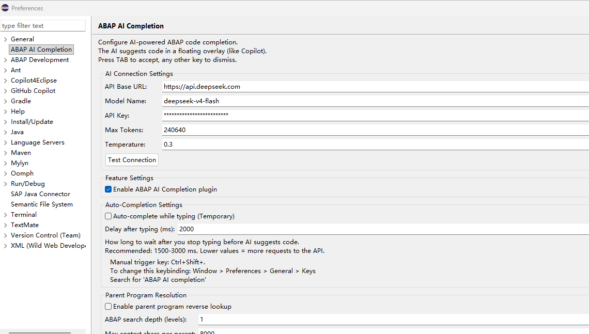
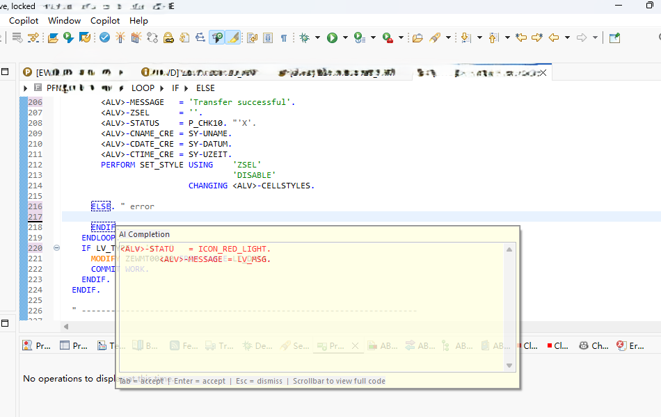
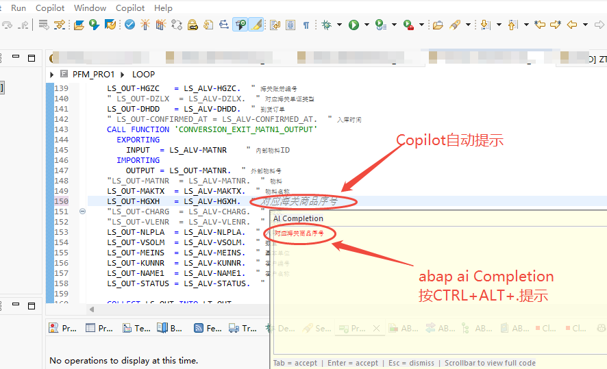

# ABAP AI Completion - Eclipse Plugin

> 🌐 **Language / 语言**: [English](README.md) | [中文](README_CN.md)



## English

An AI-powered code completion plugin for SAP ABAP developers, built for Eclipse. Based on Large Language Models (LLM), it pursues ultimate privacy and data security: local LLMs can be used inside the enterprise, preventing corporate code from being uploaded to the Internet and guaranteeing code confidentiality, while providing intelligent code suggestions and auto-completion when writing ABAP code.

### Extension Features
- **1.** A template import function is added to the menu; two template programs are currently available.
- **2.** After a program is modified and saved, the object is added to the standard "Favorite Objects" node of the SAP project tree. Since that node sorts objects alphabetically by name (independent of modification time), an additional **"Recently Modified"** node is provided, which keeps the most recently modified objects at the top for quick access to your editing history.

### Token Usage for Code Completion
- **1.** Token consumption is small when only the current program or the currently open editors are used as reference — typically a few hundred tokens. Assuming 1000 tokens per completion and DeepSeek at 0.04 CNY per million tokens, 0.04 CNY covers about 1000 completions (output is negligible), i.e. 1 CNY covers ~25,000 completions — more than enough.
- **2.** You can also use free models; during testing the free model `agnes-2.5-flash` from https://agnes-ai.cn/ worked well.

### Advantages over Copilot
- **✅ Local LLM support**: use a local LLM inside your enterprise so corporate code is never uploaded to the Internet, keeping code confidential.
- **✅ Fully open source and free for enterprise use**: no fees, no worries about code-security issues.
- **🤖 Besides the ABAP code in the current editor, AI completion can optionally include all ABAP files currently open in the workspace. Copilot only supports the current editor's code, not this.**
- **⌨️ Deep search for related code references: programs related to the current one are sent to the AI as completion context. Deep multi-level searching affects performance, so at most one level is recommended.**
- **🎯 Local SKILLs can be used as code references for the AI, so you can define custom functions or template references in SKILLs to produce better completions. Copilot also has configurable SKILLs, but they can only be used for chat, not as code references for completion.**

### Features

- **🤖 AI-powered completion**: context-aware ABAP code suggestions at the cursor position, based on AI models
- **⌨️ Manual trigger**: press `Ctrl+Shift+.` to invoke AI completion manually
- **⚡ Auto completion**: optional auto-completion mode that triggers AI suggestions after typing pauses
- **📋 INCLUDE resolution**: automatically resolves ABAP INCLUDE programs for more accurate context
- **🎯 Skill directory**: `.abap`, `.txt` and `.skill` files can be used as AI reference patterns
- **🌊 Floating overlay**: suggestions are shown in a floating overlay (Copilot style)
- **🎨 Custom styles**: the display color of completion code is customizable
- **🔌 Flexible configuration**: any endpoint compatible with the OpenAI Chat Completions API is supported
- **Manual completion (`Ctrl+Shift+.`) uses SKILLs; auto completion (`requestQuickCompletion`) uses a simplified standalone prompt and does not load the SKILL directory.**
- **Completion mode configuration**: in the preferences you can choose whether manual completion shows a popup overlay (`overlay`) or inserts directly (`direct`); both modes use SKILL content.

---

## Installation (for Users)

### System Requirements

- **Eclipse**: 4.7+ (Neon) or higher
- **Java**: JDK 17 or higher
- **Network**: access to the configured AI API service

### Installation Methods

Three installation methods are available; method 1 (Eclipse Marketplace) is recommended:

#### Method 1: Install via Eclipse Marketplace (recommended)

1. In the Eclipse menu bar open `Help` → `Eclipse Marketplace...`
2. Search for **`ABAP AI`** and find **`ABAP AI Completion`**
3. Click `Install` and follow the prompts (accept the license, trust the certificate)
4. After installation click `Restart Now (Restart Eclipse)`; the plugin is loaded after restart

#### Method 2: Install via Install New Software

1. In the Eclipse menu bar choose `Help` → `Install New Software...` (on some versions `Help` → `Install Software...`)
2. In the `Available Software` dialog click `Add...` and add the following update site:

   ```
   Name: ABAP AI Completion
   Location: https://yan252.github.io/ABAP-AI-completion/update-site
   ```

   > 💡 Alternatively click `Archive...` and select `ABAP-AI-Completion-UpdateSite-1.0.5.zip` for offline installation.

3. Check `ABAP AI Completion Feature`, click `Next` → `Next` → accept the license → `Finish`
4. After installation click `Restart Now (Restart Eclipse)`; the plugin is loaded after restart

#### Method 3: dropins (debug/development scenarios)

Copy `dist/com.sap.abap.ai.completion_1.0.5.jar` into the `<eclipse-install>/dropins/` directory (create it if it does not exist), then restart Eclipse.

---

## Usage

### Manual Code Completion

1. Open any ABAP source file (`.abap`, `.prog`, etc.)
2. Place the cursor where you want completion
3. Press `Ctrl + Shift + .` to invoke AI completion
4. The AI suggestion is shown in a floating overlay
5. Press `Tab` to accept the suggestion, any other key to cancel

### Auto-Completion Mode

After enabling **"Auto-complete while typing"** in the configuration, AI suggestions are triggered automatically after a typing pause (default 2000 ms).

### Changing the Shortcut

To change the shortcut:

1. Menu bar: `Window` → `Preferences`
2. Navigate to: `General` → `Keys`
3. Search for: `ABAP AI completion`
4. Click the `Binding` field and press the new key combination
5. Click `OK` to save

---

## Configuration

### Opening the Preference Page

1. Menu bar: `Window` → `Preferences`
2. Find **`ABAP AI Completion`** in the left navigation tree
3. The preference page looks like this:


### Configuration Details

#### AI Connection Settings

| Option | Description | Example |
|---|---|---|
| **API Base URL** | AI service endpoint | `https://api.openai.com/v1` |
| **Model Name** | AI model to use | `gpt-4`, `deepseek-v4-flash` |
| **API Key** | API authentication key | (displayed as asterisks) |
| **Max Tokens** | Maximum tokens to generate | `240640` |
| **Temperature** | Creativity temperature (0.0-2.0) | `0.3` (lower = more deterministic) |

> 💡 **Tip**: click `Test Connection` to verify the API connection.

#### Feature Settings

| Option | Description |
|---|---|
| **Enable ABAP AI Completion plugin** | Enable/disable the whole plugin |
| **Auto-complete while typing** | When enabled, AI suggestions trigger automatically after typing pauses |

#### Auto-Completion Settings

| Option | Description |
|---|---|
| **Delay after typing (ms)** | Milliseconds of typing pause before auto completion triggers |

> 💡 **Recommendation**: 1500-3000 ms. Lower values increase API request frequency.

#### Skill Directory

Place `.abap`, `.txt` or `.skill` files in the skill directory; the AI uses the code patterns in these files as completion references. This is very useful for project-specific coding standards and naming conventions.

#### Custom System Prompt

The system prompt sent to the AI can be customized to guide the AI to follow specific code styles and rules.

#### Overlay Style

Customize the display color of AI completion code in the editor.

---

## Developer Guide (Secondary Development)

### Requirements

- **JDK**: 17+
- **Eclipse**: Eclipse with Plug-in Development Environment (PDE)
- **Build tool**: Apache Maven (optional)

### Importing the Project

1. Clone the repository:

```
git clone https://github.com/yan252/ABAP-AI-completion.git
```

2. Import the project into Eclipse:

    - `File` → `Import` → `Existing Projects into Workspace`
    - Select the cloned project directory
    - Check the project and click `Finish`

### Project Structure

```
com.sap.abap.ai.completion/
├── META-INF/
│ └── MANIFEST.MF # OSGi bundle manifest
├── src/
│ └── com/sap/abap/ai/completion/
│ ├── client/ # AI API client
│ │ ├── AIClient.java
│ │ ├── AIClientException.java
│ │ └── PromptCacheManager.java # Prompt compression & multi-node cache management
│ ├── editor/ # Editor integration
│ │ ├── AICompletionHandler.java
│ │ ├── AICompletionListener.java
│ │ ├── AICompletionOverlay.java
│ │ ├── AICompletionProposalPopup.java
│ │ ├── AICompletionService.java
│ │ └── AIOverlayManager.java
│ ├── logging/ # Logging
│ │ └── AILogger.java
│ ├── parser/ # ABAP parsers
│ │ ├── AbapCodeTruncator.java
│ │ ├── AbapIncludeResolver.java
│ │ ├── AbapLanguageDetector.java
│ │ ├── ParentProgramContext.java
│ │ ├── ParentProgramResolver.java
│ │ └── WorkspaceCodeCollector.java
│ ├── preferences/ # Preference management
│ │ ├── AICompletionPreferencePage.java
│ │ ├── AIConfiguration.java
│ │ ├── PreferenceConstants.java
│ │ └── PreferenceInitializer.java
│ ├── ui/ # Status line and other UI integration
│ │ └── AbapAIStatusLineContribution.java
│ └── Activator.java # Bundle activator
├── icons/
│ └── SAPLogo.ico # Plugin icon
├── dist/ # Released JARs
│ └── com.sap.abap.ai.completion_1.0.1.jar
├── update-site/ # Update site
│ ├── features/
│ ├── plugins/
│ ├── artifacts.jar / artifacts.xml
│ ├── content.jar / content.xml
│ └── site.xml
├── tools/
│ └── CacheVerifyTool.java # Cache verification tool
├── plugin.xml # Extension point declarations
├── build.properties # Build properties
├── build.ps1 # Windows build script
├── build_plugin.xml # Build script (ANT)
├── generate-update-site.ps1 # Update site generation script
└── rebuild.ps1 # Rebuild script
```

### Key Extension Points

The plugin integrates through the following Eclipse extension points:

| Extension point | Purpose |
|---|---|
| `org.eclipse.ui.startup` | Plugin auto-start |
| `org.eclipse.ui.preferencePages` | Preference page registration |
| `org.eclipse.core.runtime.preferences` | Preference initialization |
| `org.eclipse.ui.commands` | Completion command definition |
| `org.eclipse.ui.bindings` | Shortcut binding |

### Core Architecture

1. **AIClient**: pure-Java HTTP client calling the AI Chat Completions API, no external JSON library required
2. **AICompletionService**: asynchronous completion service handling timeouts, cancellation and errors
3. **AbapIncludeResolver**: resolves ABAP INCLUDE programs to give the AI complete context
4. **AIOverlayManager**: manages display of and interaction with the floating overlay
5. **AIConfiguration**: unified configuration management backed by the preference store

### MESSAGE Nodes Sent to the AI

On manual completion (`Ctrl+Shift+.`), the plugin builds a message list of **1 `system` node + 5 `user` nodes** (see `buildUserMessages` in [AICompletionService.java](src/com/sap/abap/ai/completion/editor/AICompletionService.java)):

| Node | Role | Content |
|---|---|---|
| **System** | `system` | System prompt. Defines the AI's role (senior SAP ABAP developer), completion rules and output constraints. Can be overridden via `Custom System Prompt` |
| **Node 1/5** | `user` | **SKILL file content**: `.abap`/`.txt`/`.skill` files loaded from the skill directory, serving as code style and best-practice references. If no SKILL exists, a note states that the system default ABAP coding standard is used |
| **Node 2/5** | `user` | **Parent program call context**: when the current file is an INCLUDE, the code of parent programs that call it, found by deep search (recursive, per the configured search depth). Content is compressed by `PromptCacheManager.compressContent` |
| **Node 3/5** | `user` | **Programs open in the workspace**: other ABAP files currently open in Eclipse, as style reference and supplementary context (collected by `WorkspaceCodeCollector`, also compressed) |
| **Node 4/5** | `user` | **Program metadata**: file name, code type, INCLUDE count, and a summary of parent-program/workspace/SKILL loading status, helping the AI understand the overall context |
| **Node 5/5** | `user` | **Current program at the cursor (with cursor position)**: merged from the former "full code" and "cursor context" nodes. Shows the full code of the program at the cursor (all INCLUDEs expanded via `AbapIncludeResolver`) with `[[[CURSOR_HERE]]]` marking the insertion position — where the AI actually generates the completion |

> **Note**: nodes 2 and 3 are compressed by `PromptCacheManager.compressContent` before sending (the compression limit follows the `Max Workspace Code Chars` workspace code configuration) to avoid context-window overflow; node 1 (SKILL) is sent in full, the other nodes follow their own rules. If a node has no content, a placeholder message describing its state is still sent, so the AI always receives the complete 1+5 node structure.

> **Comparison**: auto completion (`requestQuickCompletion`) does not load SKILLs or the above context; it uses a simplified standalone prompt, sending only 1 `system` node + 1 `user` node (current line context).

### Building the Plugin

#### Export via Eclipse

1. Right-click the project → `Export`
2. Choose `Deployable plug-ins and fragments`
3. Set the output directory to `dist/`
4. Click `Finish`

#### Using the ANT Script

```
# Windows PowerShell
.\build.ps1
```

or use the provided `build_plugin.xml`:

```
ant -f build_plugin.xml
```

### Debugging the Plugin

Launch a new Eclipse instance from Eclipse for debugging:

1. `Run` → `Run Configurations`
2. Create a new `Eclipse Application` configuration
3. On the `Plug-ins` tab, ensure `com.sap.abap.ai.completion` is included
4. Click `Run`

---

## FAQ

### Q: No preference page appears after installing the plugin?

**A:** Please check:

1. The JAR file is correctly placed in the `dropins` directory
2. Eclipse has been restarted
3. The Eclipse version meets the requirement (4.7+)
4. The Java version is 17 or higher

### Q: What if code completion requests time out?

**A:**

- Check whether the network connection works
- Verify that the API Base URL and API Key are configured correctly
- Increase the `Max Tokens` and `Temperature` values in the configuration
- Try the `Test Connection` button to verify connectivity

### Q: Which AI services are supported?

**A:** Any service compatible with the OpenAI Chat Completions API, including but not limited to:

- OpenAI (GPT-4, GPT-3.5, etc.)
- Azure OpenAI Service
- Alibaba Cloud Bailian (DashScope)
- Any compatible third-party API service

### Q: Can it be used offline?

**A:** No. The plugin needs a network connection to call the AI API service. However, reference files in the skill directory can help the AI generate code that better matches project conventions.

### Q: Is the API Key secure?

**A:** The API Key is stored in Eclipse preferences and displayed as asterisks. Please note:

- Do not commit configuration files containing the API Key to version control
- Use environment variables or a key management service to store keys (if possible)

---

## Technology Stack

- **Language**: Java 17
- **Framework**: Eclipse Platform / JFace / SWT
- **API protocol**: OpenAI Chat Completions API
- **JSON handling**: pure Java (no third-party dependencies)
- **Build**: Eclipse PDE / ANT

---

## License

This project is for learning and personal use only. Please comply with the terms of service and license requirements of the AI services you use.

---

## Acknowledgements

This plugin is inspired by AI-assisted programming tools such as VS Code Copilot, aiming to provide a better coding experience for SAP ABAP developers.
